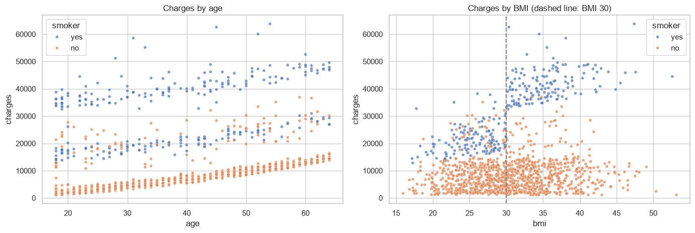
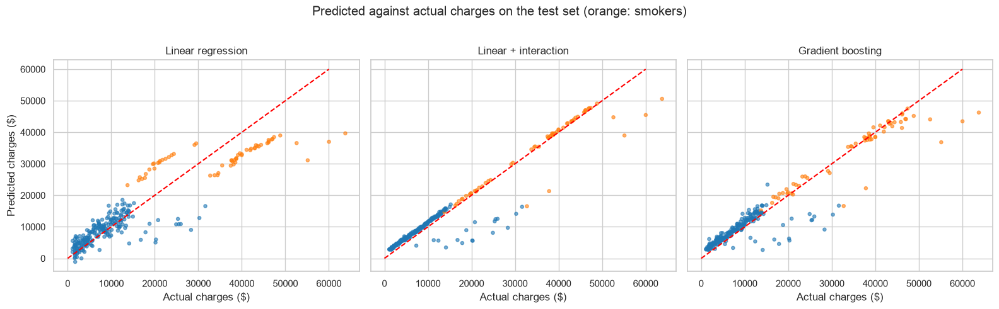

# What drives medical insurance charges?

An analysis of annual medical charges for 1,338 insurance policyholders, and a comparison of three models for predicting them. The main result is that one well-chosen interaction term makes a simple, explainable model more accurate than tuned gradient boosting.



## Findings

- **Smoking dominates.** Smokers are a fifth of policyholders and account for half of all charges: a median of $34,500 a year against $7,300.
- **BMI matters only for smokers.** Non-smokers are billed about the same above and below a BMI of 30. For smokers the median doubles, from $20,200 to $40,900.
- **Sex, region and number of children make little difference.**

| Model | Test MAE | Test R² | Cross-validated MAE |
|---|---|---|---|
| Predict the mean | $9,862 | | |
| Linear regression | $4,177 | 0.807 | $4,222 |
| Linear regression + smoker/BMI interaction | $2,269 | 0.909 | $2,377 |
| Gradient boosting (tuned) | $2,519 | 0.901 | $2,583 |

- **The interaction model is the best of the three**, and each prediction is a sum of a few dollar amounts that can be read off its coefficients: about $490 per BMI point for a smoker, and a further $14,900 for a smoker at a BMI of 30 or more.
- **Its large errors all go one way.** 8% of test customers were billed over $5,000 more than predicted, and none that much less: costs driven by things the data does not record.



## Approach

1. Explore the distribution of charges and how it varies with each feature.
2. Identify the smoker and BMI interaction from the plots.
3. Compare plain linear regression, linear regression with the interaction and an age-squared term, and gradient boosting tuned by grid search, using five-fold cross-validation and a held-out 20% test set.
4. Read the coefficients of the interaction model and look at where it misses.

## Data

`data/insurance.csv`: the medical cost dataset from Brett Lantz's *Machine Learning with R*, widely used for teaching. Columns: age, sex, BMI, children, smoker, region, charges. One duplicate row is removed.

## Running it

```bash
pip install -r requirements.txt
jupyter notebook notebook.ipynb
```

## Limits

This is a small teaching dataset with no information on existing conditions or plan type. The BMI threshold of 30 was chosen after looking at the data; it is the standard clinical definition of obesity, but the result should be confirmed on other data.

## License

The code is released under the [MIT License](LICENSE). Datasets keep the terms of their original sources, described above.
